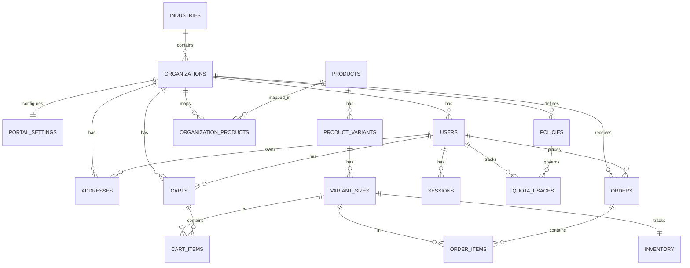
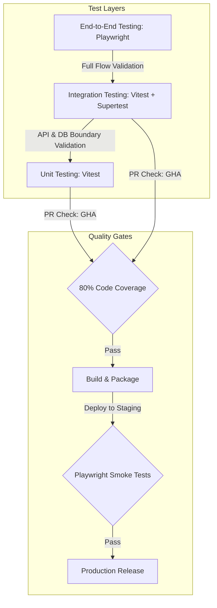

# ShopMyUniform Architecture Plan

**Stage 0: Architecture and Foundation**

## A. Product Understanding
ShopMyUniform is an organization-centric B2B uniform procurement and management platform. It manages the uniform lifecycle via organization-specific portals. 
**Core Flow**: Industry → Organization → Organization Portal → Approved Uniforms → Product → Variant / Size → Cart → Checkout → Order → Fulfillment → Reorder / Support.

## B. System Architecture
- **Monorepo** structure.
- **Frontend**: Next.js, React, TypeScript, App Router, Tailwind CSS.
- **Backend**: Node.js, Express.js, TypeScript, REST API (Modular monolith).
- **Database**: PostgreSQL (primary) via Prisma. MongoDB only if strictly required.
- **Goal**: Start simple, prioritize reliability, security, maintainability, scalability, and testability.

## C. Domain Architecture
**Core Domains**:
- Identity & Access (Users, Auth, RBAC)
- Organizations & Industries (Tenants, Policies)
- Catalog (Products, Variants, Sizes, Organization Products)
- Commerce (Cart, Checkout, Orders, Payments)
- Fulfillment (Inventory, Delivery, Addresses)
- Communication (Notifications, Support)

## D. Database Architecture

We use **PostgreSQL** as the primary relational database, interfaced via **Prisma ORM**. Multi-tenancy is enforced using **Row-Level Tenancy (Shared Database, Shared Schema)** where every tenant-scoped entity contains an `organization_id` foreign key.

### 1. Postgres vs. MongoDB Evaluation
Although catalog metadata and custom policy requirements could suggest a document database, we have decided to **reject MongoDB** and rely solely on PostgreSQL:
- **Strong Integrity & Multi-Tenancy**: A B2B platform requires strict referential integrity. Foreign keys and database-level constraints guarantee that orders, users, and addresses never become orphaned or incorrectly mapped across organization boundaries.
- **ACID Transactions**: Commerce flows (cart checkout, inventory allocation checks, outbox record generation, and balance/quota deductions) require multi-table atomic transactions. PostgreSQL ensures strict concurrency control and isolation (e.g., preventing overselling).
- **Hybrid Schema Flexibility (JSONB)**: Semi-structured data (such as organization policies, user customizations like logos/embroidery options, and the response body of idempotency records) is handled efficiently using PostgreSQL’s `JSONB` type. This provides schema flexibility without losing query performance or requiring a separate document store.
- **Simplicity**: Having a single database type simplifies our CI/CD pipelines, staging/production infrastructure, backup strategies, and developers' operational mental overhead.

---

### 2. Entity-Relationship (ER) Diagram



---

### 3. Prisma Schema Representation

The following schema defines our data model in `packages/database/prisma/schema.prisma`:

```prisma
datasource db {
  provider = "postgresql"
  url      = env("DATABASE_URL")
}

generator client {
  provider = "prisma-client-js"
}

enum Role {
  SUPER_ADMIN
  ADMIN
  ORGANIZATION_ADMIN
  STAFF
  CUSTOMER
}

enum OrderStatus {
  DRAFT
  PENDING_PAYMENT
  PLACED
  PROCESSING
  SHIPPED
  DELIVERED
  CANCELLED
}

enum PaymentType {
  INVOICE
  STRIPE
  HYBRID
}

enum PaymentStatus {
  UNPAID
  PAID
  PARTIALLY_PAID
}

enum PolicyType {
  QUOTA
  BUDGET
  APPROVAL_REQUIRED
}

enum OutboxStatus {
  PENDING
  PROCESSED
  FAILED
}

enum IdempotencyStatus {
  PROCESSING
  COMPLETED
  FAILED
}

model Industry {
  id            String         @id @default(uuid()) @db.Uuid
  name          String         @unique
  organizations Organization[]
  createdAt     DateTime       @default(now())
  updatedAt     DateTime       @updatedAt

  @@map("industries")
}

model Organization {
  id                   String                @id @default(uuid()) @db.Uuid
  name                 String
  slug                 String                @unique
  industryId           String                @db.Uuid
  industry             Industry              @relation(fields: [industryId], references: [id], onDelete: Restrict)
  portalSettings       PortalSettings?
  policies             Policy[]
  users                User[]
  organizationProducts OrganizationProduct[]
  carts                Cart[]
  orders               Order[]
  addresses            Address[]
  createdAt            DateTime              @default(now())
  updatedAt            DateTime              @updatedAt

  @@index([industryId])
  @@map("organizations")
}

model PortalSettings {
  id             String       @id @default(uuid()) @db.Uuid
  organizationId String       @unique @db.Uuid
  organization   Organization @relation(fields: [organizationId], references: [id], onDelete: Cascade)
  logoUrl        String?
  primaryColor   String       @default("#000000")
  secondaryColor String       @default("#ffffff")
  customDomain   String?      @unique
  welcomeMessage String?
  bannerUrl      String?
  createdAt     DateTime     @default(now())
  updatedAt     DateTime     @updatedAt

  @@map("portal_settings")
}

model Policy {
  id             String         @id @default(uuid()) @db.Uuid
  organizationId String         @db.Uuid
  organization   Organization   @relation(fields: [organizationId], references: [id], onDelete: Cascade)
  type           PolicyType
  rules          Json           // Details such as quota amount, limits, period
  quotaUsages    QuotaUsage[]
  createdAt      DateTime       @default(now())
  updatedAt      DateTime       @updatedAt

  @@index([organizationId])
  @@map("policies")
}

model User {
  id             String         @id @default(uuid()) @db.Uuid
  email          String         @unique
  passwordHash   String
  firstName      String
  lastName       String
  role           Role
  organizationId String?        @db.Uuid // Nullable for SUPER_ADMIN / ADMIN
  organization   Organization?  @relation(fields: [organizationId], references: [id], onDelete: Restrict)
  sessions       Session[]
  carts          Cart[]
  orders         Order[]
  addresses      Address[]
  quotaUsages    QuotaUsage[]
  createdAt      DateTime       @default(now())
  updatedAt      DateTime       @updatedAt

  @@index([organizationId])
  @@map("users")
}

model Session {
  id           String   @id @default(uuid()) @db.Uuid
  userId       String   @db.Uuid
  user         User     @relation(fields: [userId], references: [id], onDelete: Cascade)
  token        String   @unique
  expiresAt    DateTime
  isRevoked    Boolean  @default(false)
  createdAt    DateTime @default(now())

  @@index([userId])
  @@map("sessions")
}

model Product {
  id                   String                @id @default(uuid()) @db.Uuid
  name                 String
  description          String
  basePrice            Decimal               @db.Decimal(10, 2)
  sku                  String                @unique
  variants             ProductVariant[]
  organizationProducts OrganizationProduct[]
  createdAt            DateTime              @default(now())
  updatedAt            DateTime              @updatedAt

  @@map("products")
}

model ProductVariant {
  id          String        @id @default(uuid()) @db.Uuid
  productId   String        @db.Uuid
  product     Product       @relation(fields: [productId], references: [id], onDelete: Cascade)
  color       String?
  style       String?
  sizes       VariantSize[]
  createdAt   DateTime      @default(now())
  updatedAt   DateTime      @updatedAt

  @@index([productId])
  @@map("product_variants")
}

model VariantSize {
  id         String         @id @default(uuid()) @db.Uuid
  variantId  String         @db.Uuid
  variant    ProductVariant @relation(fields: [variantId], references: [id], onDelete: Cascade)
  size       String
  sku        String         @unique
  price      Decimal?       @db.Decimal(10, 2) // Price override for specific sizes
  inventory  Inventory?
  cartItems  CartItem[]
  orderItems OrderItem[]
  createdAt  DateTime       @default(now())
  updatedAt  DateTime       @updatedAt

  @@index([variantId])
  @@map("variant_sizes")
}

model OrganizationProduct {
  id             String       @id @default(uuid()) @db.Uuid
  organizationId String       @db.Uuid
  organization   Organization @relation(fields: [organizationId], references: [id], onDelete: Cascade)
  productId      String       @db.Uuid
  product        Product      @relation(fields: [productId], references: [id], onDelete: Cascade)
  customPrice    Decimal?     @db.Decimal(10, 2) // Custom org B2B contract pricing
  isVisible      Boolean      @default(true)
  createdAt      DateTime     @default(now())
  updatedAt      DateTime     @updatedAt

  @@unique([organizationId, productId])
  @@index([productId])
  @@map("organization_products")
}

model Inventory {
  id            String      @id @default(uuid()) @db.Uuid
  variantSizeId String      @unique @db.Uuid
  variantSize   VariantSize @relation(fields: [variantSizeId], references: [id], onDelete: Cascade)
  quantity      Int         @default(0) // Physical count in warehouse
  allocated     Int         @default(0) // Reserved for unpaid/pending orders
  createdAt     DateTime    @default(now())
  updatedAt     DateTime    @updatedAt

  @@map("inventory")
}

model Cart {
  id             String       @id @default(uuid()) @db.Uuid
  userId         String       @unique @db.Uuid
  user           User         @relation(fields: [userId], references: [id], onDelete: Cascade)
  organizationId String       @db.Uuid
  organization   Organization @relation(fields: [organizationId], references: [id], onDelete: Cascade)
  items          CartItem[]
  createdAt      DateTime     @default(now())
  updatedAt      DateTime     @updatedAt

  @@index([organizationId])
  @@map("carts")
}

model CartItem {
  id            String      @id @default(uuid()) @db.Uuid
  cartId        String      @db.Uuid
  cart          Cart        @relation(fields: [cartId], references: [id], onDelete: Cascade)
  variantSizeId String      @db.Uuid
  variantSize   VariantSize @relation(fields: [variantSizeId], references: [id], onDelete: Restrict)
  quantity      Int         @default(1)
  customization Json?       // JSON storing configurations (logo upload URLs, embroidery text/locations)
  createdAt     DateTime    @default(now())
  updatedAt     DateTime    @updatedAt

  @@unique([cartId, variantSizeId])
  @@index([variantSizeId])
  @@map("cart_items")
}

model Order {
  id                String        @id @default(uuid()) @db.Uuid
  userId            String        @db.Uuid
  user              User          @relation(fields: [userId], references: [id], onDelete: Restrict)
  organizationId    String        @db.Uuid
  organization      Organization  @relation(fields: [organizationId], references: [id], onDelete: Restrict)
  status            OrderStatus   @default(DRAFT)
  paymentType       PaymentType
  paymentStatus     PaymentStatus @default(UNPAID)
  totalAmount       Decimal       @db.Decimal(10, 2)
  invoiceNumber     String?
  poNumber          String?
  shippingAddressId String        @db.Uuid
  shippingAddress   Address       @relation("ShippingAddress", fields: [shippingAddressId], references: [id], onDelete: Restrict)
  billingAddressId  String        @db.Uuid
  billingAddress    Address       @relation("BillingAddress", fields: [billingAddressId], references: [id], onDelete: Restrict)
  idempotencyKey    String?       @unique
  items             OrderItem[]
  createdAt         DateTime      @default(now())
  updatedAt         DateTime      @updatedAt

  @@index([organizationId, status])
  @@index([userId])
  @@map("orders")
}

model OrderItem {
  id              String      @id @default(uuid()) @db.Uuid
  orderId         String      @db.Uuid
  order           Order       @relation(fields: [orderId], references: [id], onDelete: Cascade)
  variantSizeId   String      @db.Uuid
  variantSize     VariantSize @relation(fields: [variantSizeId], references: [id], onDelete: Restrict)
  quantity        Int
  priceAtPurchase Decimal     @db.Decimal(10, 2)
  customization   Json?
  createdAt       DateTime    @default(now())
  updatedAt       DateTime    @updatedAt

  @@index([orderId])
  @@index([variantSizeId])
  @@map("order_items")
}

model Address {
  id             String       @id @default(uuid()) @db.Uuid
  organizationId String       @db.Uuid
  organization   Organization @relation(fields: [organizationId], references: [id], onDelete: Cascade)
  userId         String?      @db.Uuid // Nullable for organization-wide default addresses
  user           User?        @relation(fields: [userId], references: [id], onDelete: Cascade)
  name           String       // Address alias (e.g. "Main Office", "Home")
  street1        String
  street2        String?
  city           String
  state          String
  postalCode     String
  country        String
  phone          String?
  isDefault      Boolean      @default(false)
  shippingOrders Order[]      @relation("ShippingAddress")
  billingOrders  Order[]      @relation("BillingAddress")
  createdAt      DateTime     @default(now())
  updatedAt      DateTime     @updatedAt

  @@index([organizationId])
  @@index([userId])
  @@map("addresses")
}

model QuotaUsage {
  id             String    @id @default(uuid()) @db.Uuid
  userId         String    @db.Uuid
  user           User      @relation(fields: [userId], references: [id], onDelete: Cascade)
  policyId       String    @db.Uuid
  policy         Policy    @relation(fields: [policyId], references: [id], onDelete: Cascade)
  allocatedAmount Decimal  @db.Decimal(10, 2)
  usedAmount     Decimal   @db.Decimal(10, 2) @default(0.00)
  periodStart    DateTime
  periodEnd      DateTime
  createdAt      DateTime  @default(now())
  updatedAt      DateTime  @updatedAt

  @@unique([userId, policyId, periodStart, periodEnd])
  @@map("quota_usages")
}

model Outbox {
  id          String       @id @default(uuid()) @db.Uuid
  eventType   String
  payload     Json
  status      OutboxStatus @default(PENDING)
  errorMsg    String?
  createdAt   DateTime     @default(now())
  processedAt DateTime?

  @@index([status, createdAt])
  @@map("outbox_events")
}

model IdempotencyRecord {
  key          String            @id
  status       IdempotencyStatus @default(PROCESSING)
  responseBody Json?
  responseCode Int?
  expiresAt    DateTime
  createdAt    DateTime          @default(now())

  @@index([expiresAt])
  @@map("idempotency_records")
}
```

---

### 4. Database Constraints & Isolation Rules

- **Primary Keys**: All tables use globally unique `UUIDv4` keys (`String @db.Uuid` mapped to native UUID types in Postgres) to secure identifier generation against enumeration attacks, except for `IdempotencyRecord` which uses the client-provided key.
- **Multi-Tenant Isolation**: Row-level tenant boundaries are maintained by attaching `organization_id` to all tenant-scoped models (`OrganizationProduct`, `User`, `Cart`, `Order`, `Address`).
- **Unique Combinations**:
  - `OrganizationProduct`: `@unique([organizationId, productId])` prevents a product from being assigned twice to the same organization catalog.
  - `CartItem`: `@unique([cartId, variantSizeId])` ensures quantity is incremented rather than creating multiple duplicate records.
  - `QuotaUsage`: `@unique([userId, policyId, periodStart, periodEnd])` prevents duplicate allocation slots for the same period.
- **Referential Actions (`onDelete`)**:
  - Crucial records (like `Organization` deletion) set to `onDelete: Restrict` or `onDelete: Cascade` for related dependent records to maintain absolute database consistency.
  - Critical commerce records (`Order`, `OrderItem`, `User`) utilize `onDelete: Restrict` where appropriate to prevent historical commerce data from being purged if a product or variant size is deleted.

---

### 5. Indexing Strategy

To guarantee sub-second query performance across high tenant counts and large product catalogs, we specify:

| Table | Index Columns | Purpose | Index Type |
|---|---|---|---|
| `organizations` | `slug` (Unique) | Domain routing resolution (e.g. `school-a.portal.com`) | B-Tree |
| `users` | `email` (Unique) | System auth login queries | B-Tree |
| `users` | `organization_id` | Multi-tenant tenant verification / user management | B-Tree |
| `organization_products` | `organization_id, productId` (Unique) | Catalog visibility lookup for a specific organization portal | B-Tree |
| `orders` | `organization_id, status` | Admin order queues filter by state and tenant | Composite B-Tree |
| `orders` | `user_id` | Customer dashboard recent order retrieval | B-Tree |
| `cart_items` | `cart_id, variant_size_id` (Unique) | Active checkout/cart quantity updates | B-Tree |
| `outbox_events` | `status, created_at` | Sweep worker querying pending outbound events in chronological order | Composite B-Tree |
| `idempotency_records` | `expires_at` | TTL cleaner background daemon removing expired idempotency tokens | B-Tree |

---

## E. API Architecture

The ShopMyUniform backend (`apps/api`) is structured as a **modular monolith** using Node.js, Express, and TypeScript. It exposes a JSON-based RESTful API designed for multi-tenancy, strict validation, and centralized error handling.

### 1. Route & Endpoint Conventions
All API endpoints are prefixed with `/api/v1` and follow standard REST resource-based naming conventions using plural nouns.

#### 1.1 Multi-Tenant Context Resolution
- **Tenant-Scoped Endpoints**: For routes belonging to specific portal domains (e.g., `/api/v1/orders`, `/api/v1/cart`), the `organization_id` is **never** passed as a path parameter. Instead, it is implicitly extracted from the user's JWT payload by the authentication middleware and enforced at the data layer (as specified in Section F.2).
- **Admin/Cross-Tenant Endpoints**: Platform-level admin routes (accessible only by `SUPER_ADMIN` and `ADMIN`) use path parameters or query parameters (e.g., `/api/v1/admin/organizations/:organizationId/orders`) to explicitly target a specific organization.

#### 1.2 Module Route Map
The API is divided into the following modules:
- **Authentication (`/api/v1/auth`)**
  - `POST /login` - User login. Generates JWT access/refresh tokens; sets secure HttpOnly cookies.
  - `POST /logout` - User logout. Revokes the session and clears cookies.
  - `POST /refresh` - Session refresh. Uses the refresh cookie to issue a new access token.
- **Organizations (`/api/v1/organizations`)**
  - `GET /` - List all organizations (restricted).
  - `POST /` - Register a new organization (restricted to `SUPER_ADMIN`).
  - `GET /:id` - Retrieve organization portal settings, branding, and policies.
  - `PATCH /:id` - Update organization details and B2B configurations.
- **Catalog & Products (`/api/v1/products`)**
  - `GET /` - List products. Automatically filters to products approved for the user's organization.
  - `GET /:id` - Get details of a single product.
  - `POST /` - Create a global product (restricted to `SUPER_ADMIN`/`ADMIN`).
  - `POST /:id/approve` - Approve a global product for an organization catalog.
- **Cart & Checkout (`/api/v1/cart`, `/api/v1/checkout`)**
  - `GET /cart` - Retrieve the active cart for the authenticated customer.
  - `POST /cart/items` - Add, update quantity, or apply custom options (e.g., logo embroidery) to a cart item.
  - `DELETE /cart/items/:itemId` - Remove an item from the cart.
  - `POST /checkout/validate` - Validate the cart against organization quotas, inventory, and policy limits.
  - `POST /checkout/submit` - Convert the cart into an order (requires `Idempotency-Key` header).
- **Orders (`/api/v1/orders`)**
  - `GET /` - List orders. Customers see their own; org admins and staff see all orders in their organization.
  - `GET /:id` - Get specific order details.
  - `PATCH /:id/status` - Transition order fulfillment states (e.g., `PLACED` -> `PROCESSING` -> `SHIPPED`).
- **Inventory (`/api/v1/inventory`)**
  - `GET /` - View current inventory levels (restricted to `STAFF`/`ADMIN`).
  - `PATCH /adjust` - Adjust stock counts for products and variants.

#### 1.3 HTTP Methods & Status Codes
We adhere to standard REST semantics:
- `GET`: Safe and idempotent. Used to retrieve resources.
- `POST`: Used to create new resources or perform non-idempotent operations (e.g., `/checkout/submit`).
- `PUT`: Idempotent. Replaces an existing resource or creates it if it doesn't exist.
- `PATCH`: Partially modifies an existing resource.
- `DELETE`: Idempotent. Removes a resource.

Common API status codes:
- `200 OK` - Request succeeded.
- `201 Created` - Resource created successfully.
- `204 No Content` - Action completed successfully, returning no payload (e.g., logout, deletes).
- `400 Bad Request` - Syntactically invalid payload or query parameters.
- `401 Unauthorized` - Authentication failed or credentials (JWT) are missing/expired.
- `403 Forbidden` - Tenant boundary cross-access attempt or insufficient RBAC privileges.
- `404 Not Found` - The requested resource does not exist.
- `409 Conflict` - Resource state conflict (e.g., duplicate unique field, duplicate idempotency key execution).
- `422 Unprocessable Entity` - Semantically invalid request (e.g., ordering items beyond remaining organization quota).
- `429 Too Many Requests` - Rate limit exceeded.
- `500 Internal Server Error` - Unhandled server-side error.

### 2. Backend Module Structure
The monorepo backend `apps/api` uses a layered modular architecture. Cross-module imports are strictly limited to prevent dependency cycles.

```
apps/api/src/
├── modules/
│   ├── auth/
│   ├── organization/
│   ├── catalog/
│   └── order/
│       ├── order.router.ts      # Express route definitions
│       ├── order.controller.ts  # Extracts HTTP input, delegates to service, sends response
│       ├── order.service.ts     # Business logic, DB operations, events
│       └── order.schemas.ts     # Domain-specific validation schemas
├── middleware/
│   ├── auth.middleware.ts       # RBAC & Tenant context injection
│   ├── error.middleware.ts      # Global centralized error handler
│   ├── validate.middleware.ts   # Zod request validation middleware
│   └── rate-limit.middleware.ts # API protection
├── server.ts                    # Server initialization
└── app.ts                       # Express app configuration & middleware pipeline
```

- **Router**: Defines HTTP verbs, paths, and registers middleware.
- **Controller**: Parses route parameters, query strings, and body payload. Hands clean data to the service layer.
- **Service**: Orchestrates business rules, interacts with Prisma, publishes Outbox events, and handles external integrations.

### 3. Request Validation (Zod)
Validation is enforced at the controller entry point via a generic `validateRequest` middleware. Zod schemas defined in `packages/shared-types` are shared across frontend and backend applications to ensure data contract consistency.

```typescript
// Example validator middleware in apps/api/src/middleware/validate.middleware.ts
import { Request, Response, NextFunction } from 'express';
import { AnyZodObject } from 'zod';

export const validateRequest = (schema: AnyZodObject) => {
  return async (req: Request, res: Response, next: NextFunction) => {
    try {
      const parsed = await schema.parseAsync({
        body: req.body,
        query: req.query,
        params: req.params,
      });
      // Replace untyped request parts with parsed and sanitized objects
      req.body = parsed.body;
      req.query = parsed.query;
      req.params = parsed.params;
      next();
    } catch (error) {
      next(error); // Caught by global error handler
    }
  };
};
```

### 4. Error Handling Architecture
We use a centralized error handler. All asynchronous router routes must catch and pass errors to Express's `next(error)`.

#### 4.1 Custom Operational Error
We define a base class `AppError` for all expected operational errors (e.g., invalid input, payment failure, authorization failure).

```typescript
export class AppError extends Error {
  constructor(
    public readonly statusCode: number,
    public readonly errorCode: string,
    message: string,
    public readonly details: any[] = []
  ) {
    super(message);
    Object.setPrototypeOf(this, new.target.prototype);
    Error.captureStackTrace(this, this.constructor);
  }
}
```

#### 4.2 Standard API Response Payload
- **Success Response**:
  ```json
  {
    "success": true,
    "data": { "id": "ord_123", "status": "PLACED" }
  }
  ```
- **Error Response**:
  ```json
  {
    "success": false,
    "error": {
      "code": "VALIDATION_FAILED",
      "message": "The provided inputs were invalid.",
      "details": [
        { "path": "body.email", "message": "Email is already in use" }
      ]
    }
  }
  ```

#### 4.3 Error Handler Middleware & Mapping
The global error handling middleware intercepts all errors:
1. **Zod Validation Errors**: Mapped to `400 Bad Request` with code `VALIDATION_FAILED` and detailed path logs.
2. **Prisma Database Errors**:
   - Unique constraints (P2002) map to `409 Conflict`.
   - Record not found (P2025) maps to `404 Not Found`.
3. **Operational Errors (`AppError`)**: Sent directly to the client with the matching `statusCode` and `errorCode`.
4. **Programmatic/Unknown Errors**: Logged using `pino` to stdout (for ingestion by GCP Cloud Logging) and sent to Sentry. In production, the client receives a generic `500 Internal Server Error` response with an opaque error tracking ID to prevent information disclosure.
```


## F. Security Architecture

**1. Role-Based Access Control (RBAC)**
- **SUPER_ADMIN**: Full system-wide access. Manages global platform settings, organizations, and highest-level configurations.
- **ADMIN**: Platform-level operator. Manages organizations, broad catalogs, and cross-organization support, but cannot alter global platform configurations.
- **ORGANIZATION_ADMIN**: Scoped to a single organization. Can manage organization-specific users (staff/customers), organization catalogs, and organization policies.
- **STAFF**: Employee of a specific organization. Handles order fulfillment and inventory for their organization but cannot manage users or organization-wide settings.
- **CUSTOMER**: End-user belonging to a specific organization. Can only access their assigned organization's portal, view approved uniforms, and manage their own carts and orders.

**2. Organization Data Isolation (Multi-Tenancy)**
- **Row-Level Tenancy**: All tenant-specific data entities (Users, Orders, Products, Carts, etc.) MUST include an `organization_id` foreign key.
- **Enforced Filtering**: The data access layer (via Prisma extensions or base repositories) must automatically apply an `organization_id` filter based on the authenticated user's session context. 
- **Strict Boundaries**: Users with `ORGANIZATION_ADMIN`, `STAFF`, or `CUSTOMER` roles are strictly blocked at the middleware layer from querying or mutating data outside their assigned `organization_id`.

**3. API Protection**
- **Authentication**: All endpoints (excluding public routes like login) require valid authentication credentials.
- **Authorization Middleware**: Declarative role-based middleware (e.g., `requireRole(['ORGANIZATION_ADMIN'])`) guards every protected route.
- **Validation**: All incoming request payloads (body, query, params) must be strictly validated and sanitized using Zod schemas to prevent injection attacks and ensure data integrity.
- **Rate Limiting**: Applied to all endpoints, with stricter limits on authentication routes (login, password reset) to prevent brute-force attacks.

**4. Session Strategy**
- **Stateless Tokens**: JWT (JSON Web Tokens) utilized for access control.
- **Secure Storage**: Tokens must be delivered via `HttpOnly`, `Secure`, and `SameSite=Strict` cookies to mitigate XSS attacks. 
- **Token Lifecycle**: Short-lived Access Tokens (e.g., 15 minutes) paired with longer-lived Refresh Tokens. Refresh Tokens are stored in the database to allow for explicit session revocation and forced logouts.
- **Payload Design**: The JWT payload will contain minimal but essential context: `userId`, `role`, and `organizationId`.
- **CSRF Protection**: Implemented for all state-mutating requests (POST, PUT, DELETE, PATCH) originating from web clients.

## G. Frontend Architecture
*(Pending proposal from Pam & Angela - Note: Agents currently archived, will assign later)*
- Focus: Route structure, Design system, Org portal, Customer flows, Admin structure.

## H. Infrastructure Architecture

### 1. Monorepo Structure & Build System
We use a **pnpm workspaces** monorepo orchestrated with **Turborepo** to manage dependencies and task pipelines.

```
shmyunic-portal/
├── apps/
│   ├── web/                 # Next.js frontend (Customer, Admin, and Org Portals)
│   └── api/                 # Node.js/Express modular monolith backend
├── packages/
│   ├── database/            # Prisma schema, migrations, seed scripts, & DB client
│   ├── shared-types/        # Shared TypeScript types, Zod schemas, & validation utilities
│   ├── ts-config/           # Shared TypeScript configurations
│   └── eslint-config/       # Shared linting rules
├── package.json             # Workspace root configuration
├── pnpm-workspace.yaml      # Monorepo workspaces definition
└── turbo.json               # Turborepo task definitions (lint, test, build caching)
```

### 2. Docker & Containerization
- **Local Development**: A `docker-compose.yml` spins up external dependencies (PostgreSQL, Redis, Mailpit).
- **Deployment Images**: Docker containers are built using multi-stage builds (`node:20-alpine`) to minimize image size (< 150MB).
  - Stage 1 (Builder): Installs all dependencies (including devDependencies) and builds the application.
  - Stage 2 (Runner): Copies only the build output (`dist`/`.next`), runtime dependencies, and configuration.
  - Prunes devDependencies and generates the Prisma client.

### 3. CI/CD Strategy
- **Platform**: GitHub Actions.
- **Continuous Integration (CI)**:
  - Triggered on PRs against `staging` and `main`.
  - Runs parallelized workspaces tasks: `pnpm lint`, `pnpm build`, and tests.
  - Runs security scans (`gitleaks` for secret detection, `npm audit` for dependencies).
- **Continuous Deployment (CD)**:
  - **Staging**: Triggered automatically on merge to `staging` branch.
  - **Production**: Triggered automatically on merge to `main` branch.
  - **Prisma Migrations**: Executed automatically during the deployment process via a GitHub Actions step before rolling out the new container version.

### 4. Environments
We maintain three environments:
1. **Local Dev**: Running on local developer machines. PostgreSQL in Docker.
2. **Staging**:
   - App Hosting: Google Cloud Run (scaled to zero when idle for cost-efficiency).
   - Database: Google Cloud SQL (Postgres, small single-AZ instance).
   - Deployed from the `staging` branch.
3. **Production**:
   - App Hosting: Google Cloud Run (configured with `min-instances: 1` for the backend to prevent cold-start latency).
   - Database: Google Cloud SQL (Postgres, high-availability multi-AZ instance).
   - Deployed from the `main` branch.

### 5. Secrets Management
- **Local**: Environment variables stored in `.env` files (explicitly gitignored).
- **Staging/Production**:
  - Secrets (DB credentials, API keys) are stored in **GCP Secret Manager**.
  - During deployment, Cloud Run references Secret Manager versions, mounting secrets directly as environment variables into the container without exposing them in CI/CD logs or Dockerfiles.

### 6. Monitoring & SRE
- **Logging**: Express backend logs formatted in JSON to stdout/stderr using `pino` or `winston`, aggregated automatically by GCP Cloud Logging.
- **Error Tracking**: Sentry integrated into Next.js and Express to capture frontend and backend runtime exceptions.
- **Health Checks**: `/healthz` endpoints implemented on Next.js and Express to facilitate zero-downtime rolling updates.

## I. Testing Strategy

We implement a multi-layered testing strategy to guarantee the correctness, security, performance, and resilience of the ShopMyUniform platform. Given the B2B, multi-tenant nature of the platform, the testing pipeline focuses on strict data isolation, transaction integrity, commerce flows, and policy enforcement.



---

### 1. Testing Pyramid & Tooling

To optimize testing speed and confidence, we divide tests into three distinct layers:

| Layer | Primary Tooling | Scope & Focus | Target Coverage |
|---|---|---|---|
| **Unit** | `Vitest` | Pure functions, UI components, custom hooks, helper classes, Zod schema validation, individual middlewares (e.g., auth, rate-limiter). | 80%+ |
| **Integration** | `Vitest` + `Supertest` | REST API routes, controllers, database query methods via Prisma (against a test Postgres DB), multi-tenant filters, transactional outbox handlers. | 75%+ |
| **End-to-End** | `Playwright` | Core client-facing browser flows, routing, Next.js page state transitions, payment integration redirects. | Critical flows only |

---

### 2. Unit Testing Strategy

Unit tests must execute in isolation, remaining completely detached from the database, external APIs, and network calls.

- **Frontend Component & Hook Tests**:
  - Tested using `Vitest` and `React Testing Library` inside a `jsdom` environment.
  - Component rendering, states (loading, error, empty), and user events (clicks, typing) are verified with mocked context providers (auth context, theme context).
- **Backend Service Logic & Validation Tests**:
  - Test pure utility functions, Zod parsing schemas, and custom error formatting in isolation.
  - Middlewares (like `rate-limit.middleware.ts` and `auth.middleware.ts`) are tested by passing mock `Request`, `Response`, and `next` function spies.
- **Mocking Strategy**:
  - **Prisma Client**: We utilize a deep-mocking strategy for `PrismaClient` using `vitest-mock-extended`. Database calls are mocked to return predictable stub data, avoiding database side effects.
  - **External Integrations**: Third-party API services (Stripe, Twilio, SendGrid) are mocked using custom service adapters. All business logic tests must assert that adapter methods are invoked with correct arguments without triggering actual HTTP requests.

---

### 3. Integration Testing Strategy

Integration tests verify the interplay between the API routes, controllers, business services, and the database.

- **Test Environment & Lifecycle**:
  - **Local Dev**: Runs against a dedicated Docker PostgreSQL instance.
  - **CI/CD Pipeline**: Spins up a service container of PostgreSQL.
  - **Prisma Lifecycle**: Before running the integration suite, `prisma migrate deploy` executes to ensure the schema is up to date.
  - **Isolation**: Each test file executes in isolation. Database tables are cleared (truncated) using a custom seed script between test suites, or wrapped in database transactions that roll back automatically to prevent test cross-contamination.
- **Tenant Isolation Verification**:
  - **Cross-Tenant Prevention**: Assert that a token belonging to `User` of `Organization A` attempting to query `GET /api/v1/orders/:id` of `Organization B` returns a `403 Forbidden` or `404 Not Found` response.
  - **Default Tenant Filters**: Assert that list endpoints (e.g. `GET /api/v1/products`) automatically filter records down to the user's `organization_id` extracted from their JWT token, verifying that no raw cross-tenant leaks occur in SQL output.
- **Idempotency & Concurrent Tests**:
  - Assert that multiple concurrent requests sent with the exact same `Idempotency-Key` to `/api/v1/checkout/submit` return a `409 Conflict` (for processing) and resolve to the identical response once finished, without duplicating invoice generations or inventory allocation logs.

---

### 4. End-to-End (E2E) Testing Strategy

E2E tests replicate actual customer actions on real browsers to ensure high-priority features work seamlessly across the stack.

- **Execution**: Run via `Playwright` in headless mode against a running instance of Next.js (`apps/web`), Express (`apps/api`), and a pre-seeded test database.
- **Session Auth Persistence**: Utilize Playwright's `storageState` to log in once, serialize the HTTP-only cookies, and reuse that state across parallel tests to reduce auth overhead.
- **Visual Regression Testing**: Capture screenshots of organization portals during portal settings updates to ensure correct primary/secondary color injection, custom logos, and mobile responsiveness.

---

### 5. Critical Test Flow: Organization to Order

The most critical test path covers the user checkout lifecycle. We enforce an integration test suite that tracks the entire flow:

```
[Tenant Domain Resolved] 
        ↓
[Filter Catalog by Org] 
        ↓
[Select Variant & Check Stock] 
        ↓
[Add to Cart & Customize] 
        ↓
[Validate Quota & Budget] 
        ↓
[Submit Order & Create Outbox Event]
```

#### Step 1: Organization Portal Resolution
- **Test**: Request portal settings by subdomain or slug.
- **Assertions**:
  - Verify `GET /api/v1/organizations/:id` returns correct brand attributes (`logoUrl`, colors, `welcomeMessage`).
  - Verify incorrect slugs/domains return `404 Not Found`.

#### Step 2: Catalog Visibility & B2B Pricing
- **Test**: Authenticate as `CUSTOMER` of `Org A` and call `GET /api/v1/products`.
- **Assertions**:
  - Assert returned product list only includes products where `organizationProducts.isVisible` is `true` for `Org A`.
  - Assert price returned is `customPrice` if defined in `OrganizationProduct`, otherwise `basePrice`.
  - Verify attempting to view a product specific to `Org B` via `GET /api/v1/products/:id` yields `404 Not Found`.

#### Step 3: Product Variant & Size Selection
- **Test**: Query variant configurations and inventory availability.
- **Assertions**:
  - Verify variant query returns size-specific price overrides.
  - Assert that inventory allocations reflect correct state: a size with `quantity: 0` returns an out-of-stock flag and blocks cart addition.

#### Step 4: Cart Management
- **Test**: Perform mutations on `POST /api/v1/cart/items`.
- **Assertions**:
  - Verify custom embroidery strings and logo upload URLs are correctly validated and stored in the `customization` JSONB field.
  - Verify that adding a duplicate `variantSizeId` to an existing cart does not create a new row, but instead increments the `quantity` field (satisfying `@unique([cartId, variantSizeId])`).

#### Step 5: Checkout Policy & Reservation Validation
- **Test**: Submit validation requests to `/api/v1/checkout/validate`.
- **Assertions**:
  - **Quota Limits**: Check that if a user has exceeded their allocation for the period, the API returns `422 Unprocessable Entity` with a `QUOTA_EXCEEDED` error code.
  - **Budget Verification**: Check that if the order total exceeds the remaining budget policy, the flow is blocked.
  - **Inventory Locking**: Validate that inventory is checked atomically. Simulating concurrent checkouts must prevent stock overselling (using Postgres `SELECT ... FOR UPDATE` isolation or transaction retry logic).

#### Step 6: Order Placement & Transactional Outbox
- **Test**: Submit order via `POST /api/v1/checkout/submit` with an `Idempotency-Key` header.
- **Assertions**:
  - Verify order is created in `DRAFT` or `PENDING_PAYMENT` (for Stripe) or `PLACED` (for PO invoice).
  - Verify database-level `Prisma` transaction atomically:
    1. Creates `Order` and `OrderItem` records.
    2. Deducts physical and allocated inventory.
    3. Clears the customer's `Cart`.
    4. Inserts `OrderPlaced` event payload into `Outbox` table.
  - Verify that the background relay or immediate in-process dispatcher processes the Outbox event to notify the fulfillment/notification service adapters.
  - Verify a second identical post with the same `Idempotency-Key` returns a cached response and doesn't create duplicate DB records.

---

### 6. Quality Gates & CI/CD Pipeline

To ensure no regression escapes to production, we enforce automated quality gates:

1. **Pre-Commit Checks**:
   - Orchestrated via `husky` and `lint-staged`.
   - Runs `prettier --write` and `eslint --fix` on staged files.
   - Executes fast-running unit tests targeting changed files.
2. **CI Pipeline (GitHub Actions)**:
   - Triggered on all Pull Requests and merges to `staging` or `main`.
   - **Linter & Compiler Gate**: Checks formatting and TypeScript type compilation (`pnpm build`).
   - **Test Gate**: Launches the Docker Postgres container, runs migrations, and executes all Unit and Integration tests.
   - **Coverage Gate**: Codecov uploads results. PRs must maintain a minimum **80% coverage** on all new and modified backend service files.
3. **CD Deployment Gates**:
   - Once code merges to `staging`, Cloud Run deploys the image.
   - Playwright E2E smoke tests execute against the staging URL.
   - If smoke tests fail or `/healthz` fails, Cloud Run rolls back to the previous revision automatically, preventing deployment of broken features.


## J. Commerce & Integration Architecture

### 1. Commerce Lifecycle & Flow
The commerce flow is designed as a modular sequence of steps that respects organization-specific rules and payment models:
1. **Cart Management**: Users add products, sizes, and customizations (such as specific school or department logos/embroideries) to their carts. Cart items are persisted in PostgreSQL to ensure cross-device consistency.
2. **Checkout Validation**: Before proceeding to payment or completion, the system runs validation checks against:
   - Organization policies (e.g., allowed items, required employee departments).
   - Allocation/Quota constraints (e.g., a student or employee might be limited to 2 shirts per semester, or a maximum dollar budget covered by the company).
   - Current inventory availability.
3. **Order Placement**: Once validation succeeds, the checkout is submitted with an idempotency key. An order is created in a `DRAFT` or `PENDING_PAYMENT` state.
4. **Fulfillment Hand-off**: Upon successful payment or corporate billing approval, the order transitions to `PLACED`, triggering downstream inventory deduction and communication events.

### 2. Billing & Payment Strategies
The platform supports three distinct billing flows depending on organization settings:
- **Direct Corporate Billing (B2B Invoice/PO)**: The organization pays directly. Order is created in a `PROCESSING` state upon validation of a valid Purchase Order (PO) number or corporate account status.
- **Individual Employee Payment**: The user pays out of pocket. Integrated via a secure hosted payment gateway (e.g., Stripe) using redirect or elements.
- **Hybrid (Co-payment / Allocations)**: The organization covers up to a set allocation (e.g., $100 or specific item quotas), and any excess cost is paid by the individual via credit card.

Payment processing is decoupled via a `PaymentService` interface. Webhooks are utilized to asynchronously handle payment success or failure events to ensure the system is resilient to client-side network interruptions.

### 3. Idempotency Strategy
To prevent double charging and duplicate order creation (e.g., due to user double-clicking or network retries), the commerce API enforces request idempotency for state-changing operations (`/checkout/submit`, `/payments/charge`, `/orders/create`):
- **Client-Side Key Generation**: Clients generate a unique UUIDv4 `Idempotency-Key` and send it as an HTTP header.
- **Idempotency Registry**: An `IdempotencyRecord` table in the database tracks:
  - `key` (Unique primary key)
  - `status` (`PROCESSING`, `COMPLETED`, `FAILED`)
  - `response_body` (Serialized JSON response)
  - `response_code` (HTTP status code)
  - `expires_at` (TTL of 24 hours)
- **Execution Flow (Middleware)**:
  1. The API checks the registry inside a transaction.
  2. If the key exists and status is `COMPLETED`, it returns the cached response immediately.
  3. If status is `PROCESSING`, it returns a `409 Conflict` (request already in progress).
  4. If the key is new, the server inserts a record with `PROCESSING` and proceeds with the business logic.
  5. On success, it updates the record to `COMPLETED` along with the response payload. On unrecoverable error, it updates to `FAILED` or deletes the key to allow retry.

### 4. Integration & Loose Coupling via Event-Driven Architecture
To maintain a modular monolith and avoid tight coupling between the core commerce engine and external integrations (such as ERP syncs, shipping providers, and notifications), we implement the **Transactional Outbox Pattern**:
- **Outbox Engine**: Within the same database transaction that creates or updates an order, an event record (e.g., `OrderPlacedEvent`) is inserted into an `Outbox` table.
- **Event Relay**: *[Architectural Resolution by Michael]* Since the infrastructure uses GCP Cloud Run (which can scale to zero), a continuous polling background worker is anti-pattern. Instead, the application will use an in-process asynchronous event dispatcher immediately after the transaction commits. If the process crashes before dispatch, a lightweight scheduled job (e.g., triggered via GCP Cloud Scheduler hitting a secured webhook endpoint) will act as a fallback to sweep and process pending outbox events.
- **Integration Handlers**: Independent service modules subscribe to these events:
  - `InventoryService` listens to update stock counts.
  - `FulfillmentService` listens to sync details to the warehouse.
  - `NotificationService` listens to dispatch alerts.

### 5. Communication & Notification Integration
The `NotificationService` handles external outreach channels (Email and WhatsApp) in a highly decoupled manner:
- **Abstraction**: Providers (e.g., SendGrid for Email, Twilio/WhatsApp Business API for WhatsApp) are wrapped in custom adapters implementing `EmailProvider` and `WhatsAppProvider` interfaces.
- **Trigger Events**:
  - `Order Placed / Confirmed` (Sends receipt/PO summary).
  - `Order Dispatched` (Sends tracking details).
  - `Allocation Refills / Expiry` (Alerts organization employees).
- **Resilience**: The notification queue uses an exponential backoff retry mechanism to survive rate limits and temporary outages of external communication APIs.

